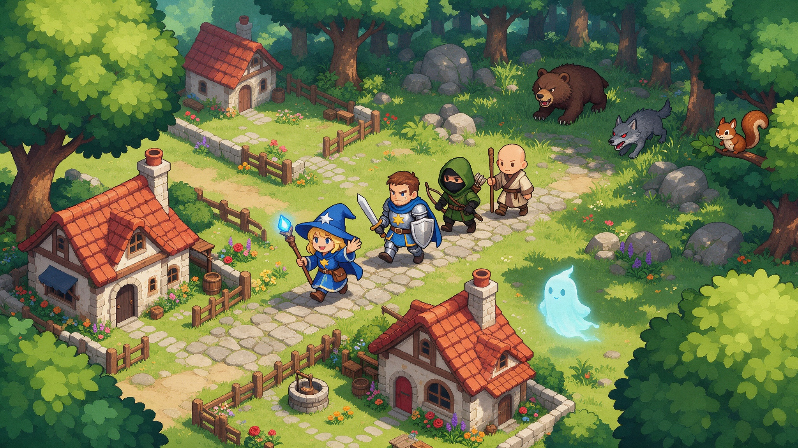

# OpenRPG

A classic turn-based 2D RPG template for Summer Engine: explore a town and forest on a grid, talk to villagers, and fight monsters in sequential turn-based battles.

OpenRPG is built on GDQuest's open-source [Godot 4 Open RPG](https://github.com/gdquest-demos/godot-open-rpg) demo, which shows one solid way to create and structure the code for a 2D RPG. You can reuse the code in your own projects, and also learn from the project's codebase.

## What's inside

- **Grid-based overworld**: a town, a house and a forest with map transitions, click-to-move pathfinding and keyboard movement (`src/field/`).
- **Classic turn-based combat**: each round you choose actions and targets for your party, then everyone acts in turn (`src/combat/`).
- **Battle actions as code**: attack, heal, projectile and stat-modifier actions you can extend.
- **Monsters to fight**: bear, wolf, squirrel and bugcat battlers.
- **Dialogue and cutscenes** with the Dialogic add-on, plus interactions such as the wand pedestal.
- **Inventory, screen transitions and music** for field and combat.

## Get started

1. Download this repo as a [ZIP](https://github.com/SummerEngine/template-2d-rpg/archive/refs/heads/main.zip) or clone it.
2. Open the folder in [Summer Engine](https://www.summerengine.com/download).
3. Press Play.

Summer's AI agent can extend the game for you. Try:

- "Add a fire spell that hits every enemy and costs mana."
- "Add a cave map north of the forest with a new boss battle."
- "Add a shopkeeper in town who sells potions."

## Controls

| Action | Keyboard | Gamepad / mouse |
|--------|----------|-----------------|
| Move | W A S D or arrow keys | D-pad |
| Move to a cell | | Left click |
| Interact | Space | |
| Advance dialogue | Enter, Space or X | |
| Back (combat menus) | Esc | |

## Project goal

The goal of the original project is to give the gamedev community a demo that shows one solid way to create and structure the code for a 2D RPG in Godot 4. The focus is on a learning resource that is both practical and educational, not a framework. The code:

- Takes advantage of what GDScript 4 has to offer.
- Is accessible to users with solid code foundations, a good starting point and reference for an RPG project.
- Follows the [GDQuest GDScript guidelines](https://gdquest.gitbook.io/gdquests-guidelines/godot-gdscript-guidelines).

See [CHANGELOG.md](CHANGELOG.md) for how the combat and overworld systems evolved.

## Credits

Built on the work of [GDQuest](https://www.gdquest.com/). Follow them on [Twitter](https://twitter.com/NathanGDQuest) and [YouTube](https://www.youtube.com/c/gdquest/) for Godot tips and tutorials, and get one of their [Godot game creation courses](https://www.gdquest.com/product/) to support their work on Free Software. Their [Contributors Guide](https://gdquest.gitbook.io/gdquests-guidelines/contributing-to-gdquest-projects/) covers how to contribute.

The project uses the asset pack [Tiny Town by Kenney](https://kenney.nl/assets/tiny-town). All external assets (Kenney, Zane Little Music, food_please) are listed with their CC0 licenses in [CREDITS.md](CREDITS.md). Dialogue runs on the [Dialogic](https://github.com/dialogic-godot/dialogic) add-on in `addons/dialogic`.

## License

Code is MIT and GDQuest art assets are CC-By 4.0, see [LICENSE](LICENSE). Please credit GDQuest when you reuse the code or art.
